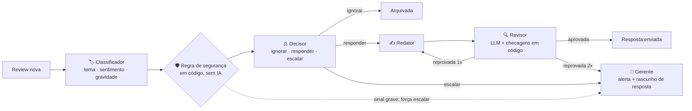

# Central de operações de reviews com IA

**Agentes de IA que leem avaliações de restaurantes, entendem o problema, decidem o que fazer e respondem ao cliente, e que sempre passam os casos graves para uma pessoa.**

🔗 **Demo ao vivo:** [central-reviews-ai.streamlit.app](https://central-reviews-ai.streamlit.app/) · 🎥 **Vídeo de 2 min:** [LINK_DO_VIDEO](LINK_DO_VIDEO)

Construído do zero em ~2 dias (11 e 12/11/2026), de ponta a ponta: dados → prompts avaliados → agentes → automação → dashboard publicado.

---

## O problema

Um restaurante com dezenas de lojas recebe centenas de avaliações. Na prática:

- **ninguém lê tudo**, e as reclamações viram ruído;
- **casos graves se perdem no meio** (inseto na comida, alguém que passou mal, discriminação, ameaça), e são justamente os que geram risco à saúde, processo e crise de imagem;
- responder uma por uma é lento e as respostas saem inconsistentes;
- o gerente não sabe **qual problema** atacar primeiro nem **em qual loja**.

## A solução

Um pipeline que faz a triagem sozinho e só chama uma pessoa quando precisa:



| Peça | O que faz |
|---|---|
| **4 agentes** | Classificador → decisor → redator → revisor. Cada um com prompt próprio, versionado em [`prompts/`](prompts/), e saída validada (JSON + Pydantic). |
| **Trava de segurança** | Uma regra determinística ([`seguranca.py`](src/ifood/seguranca.py)) detecta saúde, corpo estranho, discriminação, violência e segurança do local, e **força a escalada mesmo que o modelo discorde**. |
| **Revisor com dois filtros** | O LLM confere tom e coerência, e o código bloqueia promessa de reembolso/cupom, citação da marca e textos longos. A resposta pode ser reescrita uma vez; se for reprovada de novo, vai para uma pessoa. |
| **Automação** | Um CSV novo em `data/inbox/` é processado sozinho; casos graves geram alerta em arquivo e num **webhook** configurável (Slack/Teams/Discord) ([`pipeline.py`](src/ifood/pipeline.py)). |
| **Dashboard** | Streamlit com visão geral, mapa 3D das lojas, ranking, fila de casos escalados, "por dentro dos agentes" (o caminho de cada review) e qualidade da IA. **Não chama modelo**: lê resultados pré-calculados, então abrir a demo custa zero. |

## O resultado

Amostra de **500 reviews** (estratificada por nota, de uma base limpa de 23.287), rodando num modelo **local e gratuito** (`qwen2.5:7b` via Ollama):

| Indicador | Resultado |
|---|---|
| Casos de gravidade alta encaminhados a uma pessoa | **30 de 30** |
| Resolvidas sem humano (respondidas ou arquivadas) | **451 (90%)** |
| Escaladas ao gerente | 49 (10%) |
| Respostas aprovadas pelo revisor na 1ª tentativa | 423 |
| Respostas com JSON inválido (corrigido no retry) | 0,7% |
| Custo | **US$ 0** (modelo local) |
| Horas economizadas *(estimativa)* | **≈ 23 h de 25 h**, considerando 3 min de trabalho manual por review |

> **Sobre as horas:** é uma estimativa, não uma medição. A premissa é que uma pessoa leva ~3 min para ler, classificar, decidir e responder cada review. Sem IA, isso dá 500 × 3 min = 25 h. Com IA, só as 49 escaladas continuam com alguém (2,5 h). No dashboard, a premissa é um controle ajustável.

**8 casos de gravidade baixa/média também foram escalados** porque o revisor reprovou a resposta duas vezes. É de propósito: na dúvida, o sistema prefere uma pessoa a uma resposta ruim.

## Como escolhi o prompt (com dados, não no olho)

Rotulei um gabarito de 50 reviews (10 por nota) e testei 4 versões do prompt de classificação ([`avaliar_prompts.py`](src/ifood/avaliar_prompts.py)):

| Versão | O que muda | Tema | Gravidade | Sentimento × nota | JSON inválido | Tokens/chamada |
|---|---|---|---|---|---|---|
| v1 | instrução simples | 60% | 52% | 60% | 31% | 297 |
| **v2** ✅ | papel + definições + 4 exemplos | **80%** | 90% | 72% | 0% | 782 |
| v3 | + 9 regras de casos de borda | 76% | 96% | 68% | 2% | 1.224 |
| v4 | + "o tema é o assunto da reclamação" | 76% | 96% | 72% | 0% | 1.437 |

**Escolhi a v2**, a melhor relação acerto × custo. Acrescentar regras (v3, v4) não melhorou o tema, só mudou onde o modelo erra, e quase dobrou os tokens.

O dado mais importante da tabela é outro: **o modelo deixou passar um dos 2 casos graves** do gabarito (uma mosca no suco) em todas as versões a partir da v2. Por isso a segurança não depende do modelo: a regra em código pega os 2.

## Modelo local × nuvem

Mesmo gabarito, mesmos prompts, mesma métrica ([`comparar_modelos.py`](src/ifood/comparar_modelos.py)). Para trocar de modelo, bastou mudar uma linha do `.env`:

| Modelo | Prompt | Tema | Gravidade | Graves detectados | Latência (mediana) | Custo por 1.000 reviews* |
|---|---|---|---|---|---|---|
| `qwen2.5:7b` (local, CPU) | v2 | 80% | 90% | 1/2 | 22 s | US$ 0 |
| `qwen2.5:7b` (local, CPU) | v4 | 76% | 96% | 1/2 | 22 s | US$ 0 |
| `gemini-3.5-flash-lite` (API) | v2 | 94% | 82% | 1/2 | 1,7 s | US$ 0,33 |
| **`gemini-3.5-flash-lite` (API)** | **v4** | **96%** | **94%** | **2/2** | **1,7 s** | **US$ 0,51** |

\* Pelo preço do plano pago. A rodada foi feita no plano gratuito, então o custo real foi US$ 0.

**Isso é estatisticamente confiável?** Com 50 reviews, parte disso sim e parte não:
- ✅ **O Gemini acerta mais o tema que o modelo local.** Nas mesmas reviews, ele acertou 9 que o local errou, contra 1 no sentido oposto (teste de McNemar, p = 0,02).
- ❌ **v4 × v2 no Gemini (96% × 94%) é empate:** a diferença é 1 review.
- ❌ **"2/2 graves" não prova nada:** o gabarito só tem 2 casos graves.
- Cada acurácia tem margem larga: o local fica entre 67% e 89%, e o Gemini entre 87% e 99% (IC 95%).

**O que aprendi com isso:**
- **Melhorar o prompt teve efeito diferente em cada modelo.** As regras extras da v4 não ajudaram o modelo pequeno. No Gemini, a v4 empatou no tema e foi melhor na gravidade (94% × 82%). Para saber se esse ganho é real, preciso de um gabarito maior, e esse é o próximo passo.
- **A troca é de negócio, não só técnica.** O modelo local é grátis e privado, mas 13× mais lento. A API custa ~US$ 0,50 por mil reviews: menos de um centavo por review, com 1,7 s de resposta.
- **A trava de segurança continua.** Mesmo com 2/2 no gabarito, um caso grave perdido custa muito mais que a regra em código.
- **Cuidado:** o gabarito foi rotulado com auxílio de LLM, o que pode favorecer modelos maiores. Os números servem para comparar opções, não como acurácia absoluta.

## Decisões de projeto

- **Custo sob controle desde o início.** Nada roda no dataset inteiro sem pedido explícito. Todo script que chama modelo mostra antes a estimativa (chamadas × tokens × preço) e pede confirmação se o modelo for pago. Cache em disco: rodar de novo não custa nada e uma execução interrompida retoma de onde parou.
- **Uma porta só para os modelos.** Todas as chamadas passam por uma função ([`llm.py`](src/ifood/llm.py)) com [litellm](https://github.com/BerriAI/litellm). Trocar o Ollama local por Gemini ou Claude (API) é só mudar o `.env`; nenhum nome de modelo está no código.
- **Toda chamada fica registrada.** Modelo, tokens, custo, latência, falhas de JSON e erros vão para `outputs/runs.jsonl`.
- **Humano no circuito onde importa.** O sistema automatiza o volume e deixa para a pessoa a decisão de risco.
- **IA só onde ela é melhor.** Limpeza, deduplicação, amostragem, regra de segurança e as perguntas do dashboard são pandas e regras, que são mais baratas, previsíveis e testáveis.
- **Testes sem custo.** 42 testes com um modelo falso (`uv run pytest`).

## O que deu errado (e como resolvi)

- **Os emojis já vinham destruídos no CSV original** (91 mil caracteres `�`). Recuperei os apóstrofos ("don�t" → "don't") e marquei as 3.037 reviews afetadas, em vez de fingir que o texto estava íntegro.
- **10 mil reviews duplicadas** (30% da base) e uma loja com endereço corrompido. A loja corrompida foi mantida como "Desconhecida", para não descartar 660 reviews.
- **Uma chamada "levou" 19 horas:** o PC suspendeu no meio da execução. Passei a reportar a **mediana** da latência em vez da média.
- **Timeouts em CPU** com prompts maiores: aumentei o timeout e adicionei retry.
- **Os agentes se contradiziam:** o revisor reprovava frases que o redator tinha sido instruído a usar ("vou compartilhar com a equipe"). Alinhei os dois prompts (v2) e as aprovações subiram de 38 para 42 de 45 no gabarito.
- **O redator concordou com uma reclamação preconceituosa** de um cliente. Adicionei uma regra explícita contra isso. Ainda há 1 caso no gabarito com termo inadequado: é uma limitação conhecida, e mais um motivo para o revisor existir.

## Limitações e próximos passos

- O gabarito tem 50 reviews e foi rotulado **com auxílio de LLM**, então serve para comparar versões de prompt, mas é pequeno para afirmar acurácia absoluta.
- Ampliar o gabarito para ~150 reviews, com mais casos graves, para que as diferenças entre prompts e modelos tenham significância estatística.
- Rodar os 4 agentes nas 500 reviews com o modelo da API, para comparar o pipeline inteiro e não só a classificação.
- Incluir um terceiro fornecedor (Claude) na comparação: o script já aceita vários modelos.
- Modo incremental, para ampliar a amostra aos poucos sem reprocessar o que já foi analisado.

## Como rodar

Requer Python 3.10+ e [uv](https://docs.astral.sh/uv/). Para o modelo local, [Ollama](https://ollama.com/) com `ollama pull qwen2.5:7b`.

```bash
uv sync
cp .env.example .env                          # escolha o modelo: local (Ollama) ou API (Anthropic)
# baixe o CSV do Kaggle (McDonald's Store Reviews) em data/raw/
uv run python -m ifood.data_prep              # limpeza + amostra estratificada
uv run python -m ifood.avaliar_prompts        # compara as versões de prompt no gabarito
uv run python -m ifood.agentes --fonte amostra   # roda os 4 agentes (mostra a estimativa de custo antes)
uv run python -m ifood.exportar_dashboard     # gera os dados do dashboard
uv run streamlit run app/dashboard.py

# automação
uv run python -m ifood.pipeline --simular 5 --com-grave   # simula reviews novas chegando
uv run python -m ifood.pipeline                           # processa a inbox (ou --observar)

uv run pytest
```

Estrutura: `src/ifood/` (código) · `prompts/` (prompts versionados) · `app/` (dashboard) · `outputs/` (resultados agregados) · `tests/`.

## Dados e aviso

- Usa um dataset público do Kaggle (*McDonald's Store Reviews*). A licença do dataset não está especificada, então **o texto original das reviews não é redistribuído**: o repositório só traz resultados derivados e agregados.
- Projeto de portfólio pessoal, **sem vínculo com o McDonald's nem com o iFood**. O nome do pacote (`ifood`) é só uma referência à vaga para a qual o projeto foi feito.
